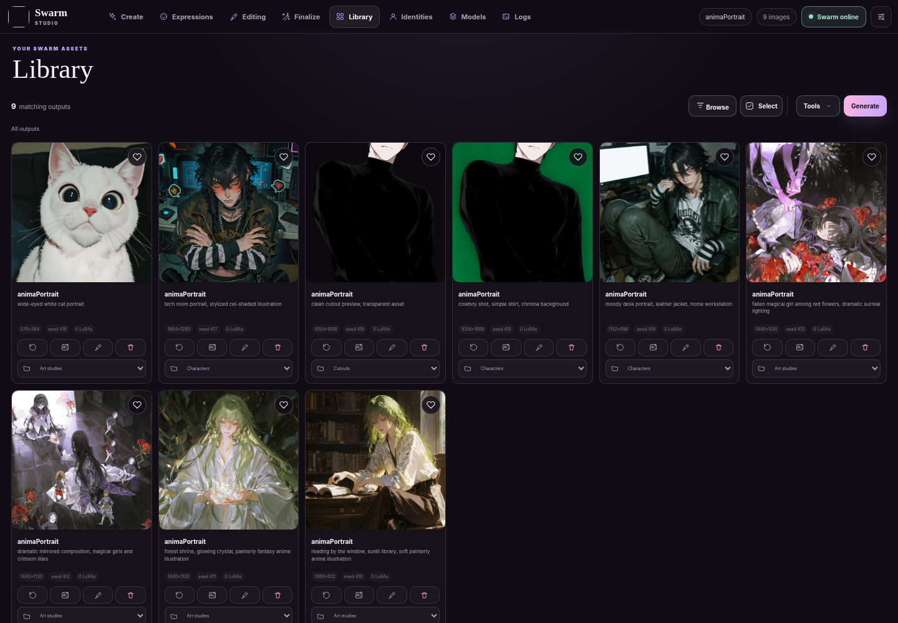
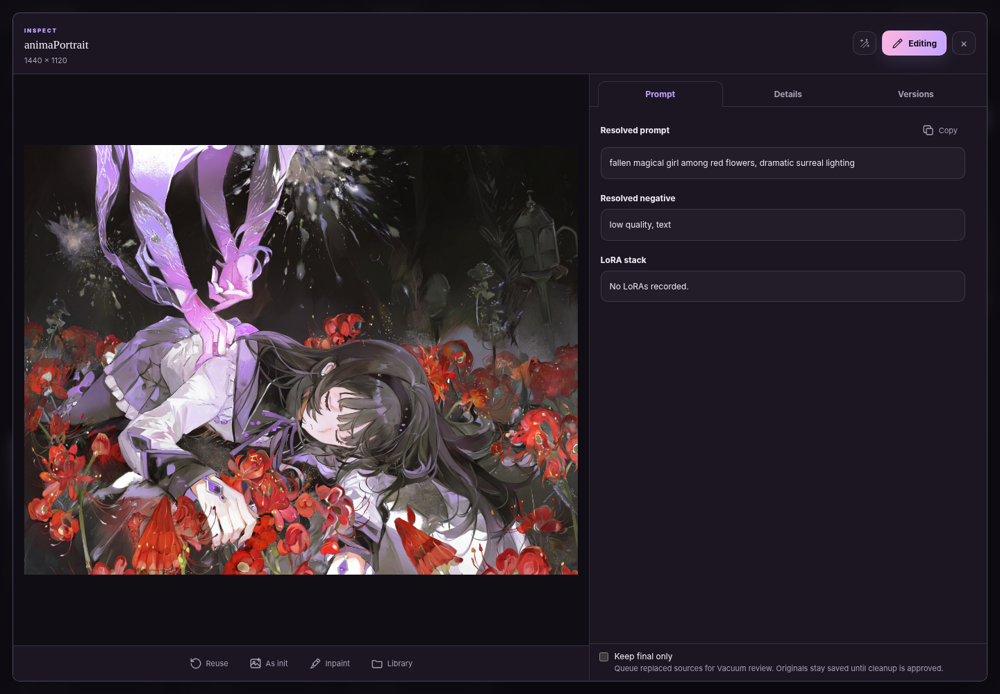
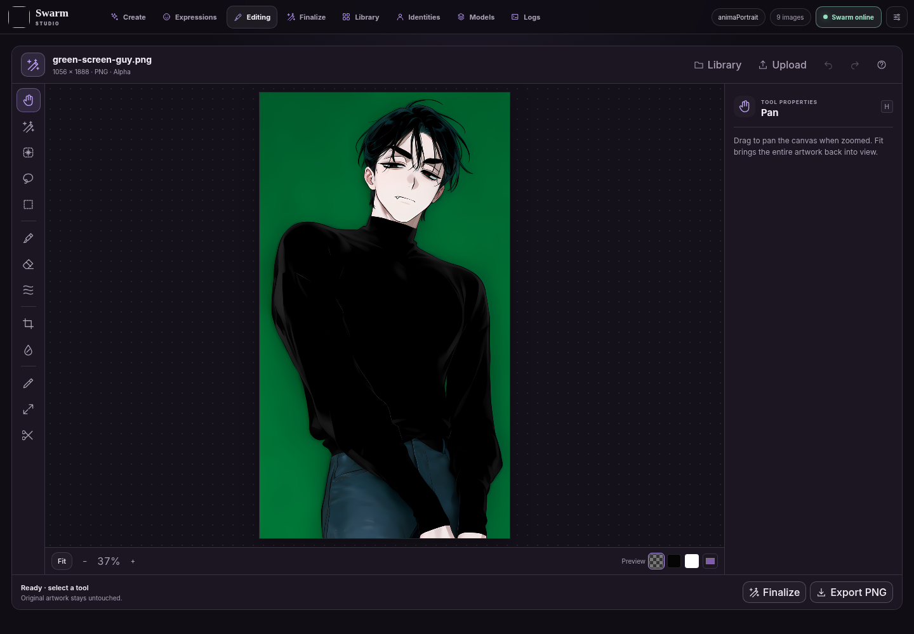
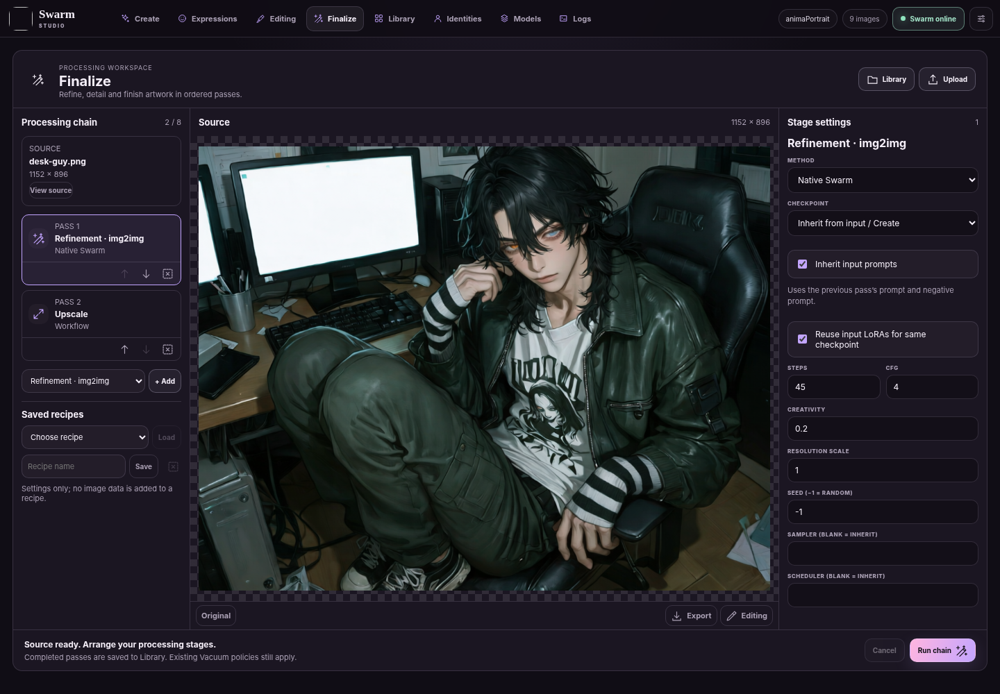

# Swarm Studio

**Swarm Studio** is a standalone PWA + Tauri creative client for **SwarmUI**.
It gives you a cleaner day-to-day workspace for generating, browsing, inspecting, editing, organizing, and refining images without replacing SwarmUI as the backend.

> The screenshots below use curated mock data and sample outputs so the README shows the app in a realistic state instead of empty placeholder cards.


## Why use it?

Swarm Studio is built for the parts of image workflows that tend to get messy fast:

- **Create** with focused prompting, checkpoints, LoRAs, presets, advanced Swarm controls, and live progress.
- **Browse a real library** instead of a raw dump of generations.
- **Inspect metadata** quickly: prompt, negative, model, seed, LoRAs, timings, and reuse actions.
- **Edit and inpaint** inside a dedicated image workspace.
- **Finalize** images in ordered passes like refine → upscale → background removal.
- **Manage assets** with folders, favorites, batch tools, model browsing, and CivitAI helpers.
- **Run it as a desktop app or PWA** while still talking to the same Swarm backend.

## Workspace tour

### Library

The Library gives you a local, folder-aware view of Swarm outputs with favorites, selection, batch tools, and quick actions.



### Inspect

Inspect opens prompt details, versions, metadata, and reuse/init/inpaint actions without forcing you into a separate utility flow.



### Editing

The editing workspace is meant for direct image work: pan/zoom, layered tools, inpaint setup, cutouts, and exporting cleaned assets.



### Finalize

Finalize is the render-lab pass chain: refine, upscale, workflow passes, background cleanup, and export in a single processing workspace.



## Core feature map

### Create

- checkpoint / sampler / scheduler controls
- LoRA stacks and preset workflows
- advanced Swarm parameters
- optional review-before-save flow
- prompt enhancer support
- init image and variation workflows

### Library + Inspect

- locally indexed Swarm outputs
- folders, favorites, and batch actions
- quick reuse / as-init / inpaint / finalize handoff
- transient inspection of dropped Swarm PNG/JPEG files
- prompt/model/seed/LoRA metadata
- prep and generation timing when present in metadata

### Editing + Inpaint

- dedicated editing canvas
- inpaint mask workflows
- export-oriented cleanup
- image-to-image handoff into Finalize

### Finalize

- ordered multi-pass processing
- refine, upscale, and workflow stages
- reusable recipes
- source preservation and export flow

### Models / LoRAs / CivitAI

- checkpoint and LoRA browsing
- folder-aware filtering
- compatibility-oriented browsing
- CivitAI discovery and direct install helpers
- URL normalization through `civitai.red`

### Identities / Settings / Logs

- reusable subject identities
- compressed avatar persistence in IndexedDB
- backend controls for Swarm / Comfy
- diagnostics, memory controls, and runtime logs
- appearance, keybinds, and workflow settings

## Lumi ecosystem / companion repo

If you are using the wider Lumi stack, you may also want the companion **LumiSwarm** repo:

- **LumiSwarm Studio:** <https://github.com/kittyafterdark/LumiSwarm-Studio>

Swarm Studio is the focused creative client; LumiSwarm can sit beside it as part of a broader queue / workflow / cleanup setup.

## Start on Windows

Run:

```powershell
.\start.ps1
```

The launcher:

- installs JavaScript dependencies when needed
- creates or refreshes the desktop shortcut
- creates a separate **Swarm Studio - Emergency Stop** shortcut
- starts the Tauri desktop app in one PowerShell window

Normal launches do **not** modify Windows Firewall or open an elevated secondary shell.

If Windows Firewall really is blocking phone/LAN access to port `1420`, run this once from the project folder:

```powershell
.\start.ps1 -SetupFirewall
```

That optional setup may request elevation; later normal launches stay unelevated.

For browser/PWA development, use:

```bash
npm run dev
```

If a Studio-owned Swarm / Comfy process tree starts crash-looping, use the **Swarm Studio - Emergency Stop** desktop shortcut or run:

```powershell
.\start.ps1 -EmergencyStop
```

For separate installs without StabilityMatrix, see [standalone startup](docs/STANDALONE-STARTUP.md).

## Updating Studio

Desktop Studio and the mobile remote can update the host checkout after the repo has been cloned once.

Highlights:

- **Update available** appears only when the tracked remote is ahead.
- **Update & restart** requires a clean fast-forwardable checkout.
- Studio refuses destructive reset/clean behavior.
- Remote clients reconnect after the replacement host comes back.
- update diagnostics are written to `.swarm-studio-update.log`

The update controls live in **Settings → Backends**.

## Prompt enhancer

Configure **Settings → LLM enhancer**, write a positive prompt or instruction, then use **✦ Enhance** beside **Prompt**.

See:

- [Prompt enhancer guide](docs/PROMPT-ENHANCER.md)
- [Expression Studio](docs/EXPRESSION-STUDIO.md)

## Persistence and metadata

Studio keeps its own lightweight UI/library state locally while Swarm remains authoritative for:

- model files
- generated outputs
- backend history

Notes:

- the persisted browser cache intentionally keeps only the newest **220** output records
- the first connected **Library** visit of a session rehydrates that compact cache from Swarm history
- dropped images are inspected transiently and are not automatically added to the Library
- identity pictures are stored as compressed assets in **IndexedDB**, not just localStorage

Swarm PNG `parameters` metadata and supported JPEG `UserComment` metadata are parsed locally. When available, Studio surfaces timing fields such as `prep_time` and `generation_time`.

## Development

```bash
npm ci
npm run check
npm run preflight
npm run build
```

Desktop development/build commands:

```bash
npm run tauri:dev
npm run tauri:build
```

To refresh the README showcase screenshots locally:

```bash
STUDIO_TEST_CHROMIUM=/usr/bin/chromium python tests/readme-showcase.py
```

## Repository hygiene

Generated builds, dependency folders, runtime logs, local recovery backups, editor state, and Tauri target output are ignored by Git.

Git tracks:

- `package-lock.json`
- `src-tauri/Cargo.lock`

The repository enforces LF line endings through `.gitattributes`, including `start.ps1`, so Windows checkouts do not silently rewrite the editable tree to CRLF.
